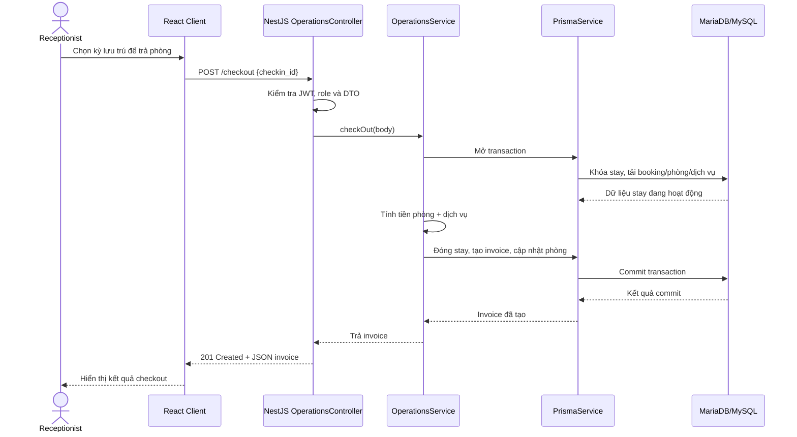

# Sequence Diagram — Check-out

Tất cả thao tác ghi checkout cùng nằm trong transaction; lỗi trước commit sẽ
rollback việc đóng stay, tạo hóa đơn và cập nhật trạng thái phòng. API checkout
không tự thu tiền; thanh toán được ghi riêng qua `POST /payments`.
